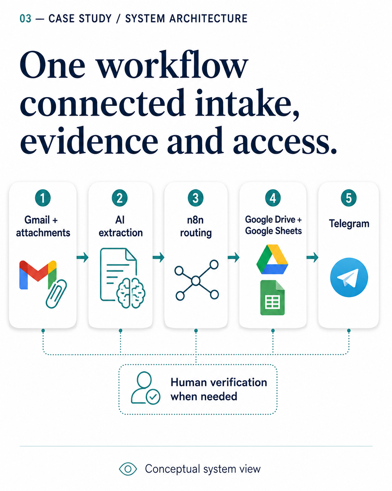
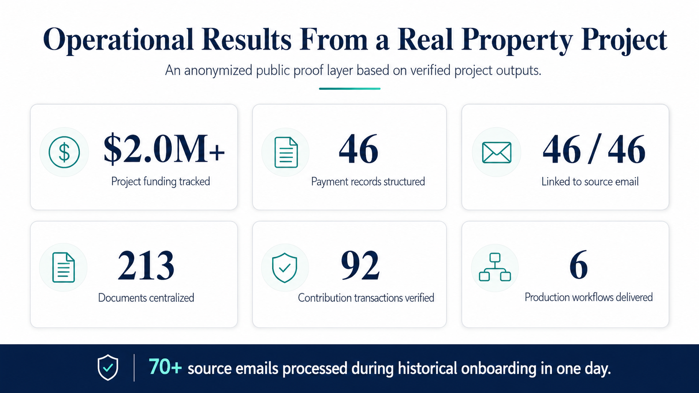
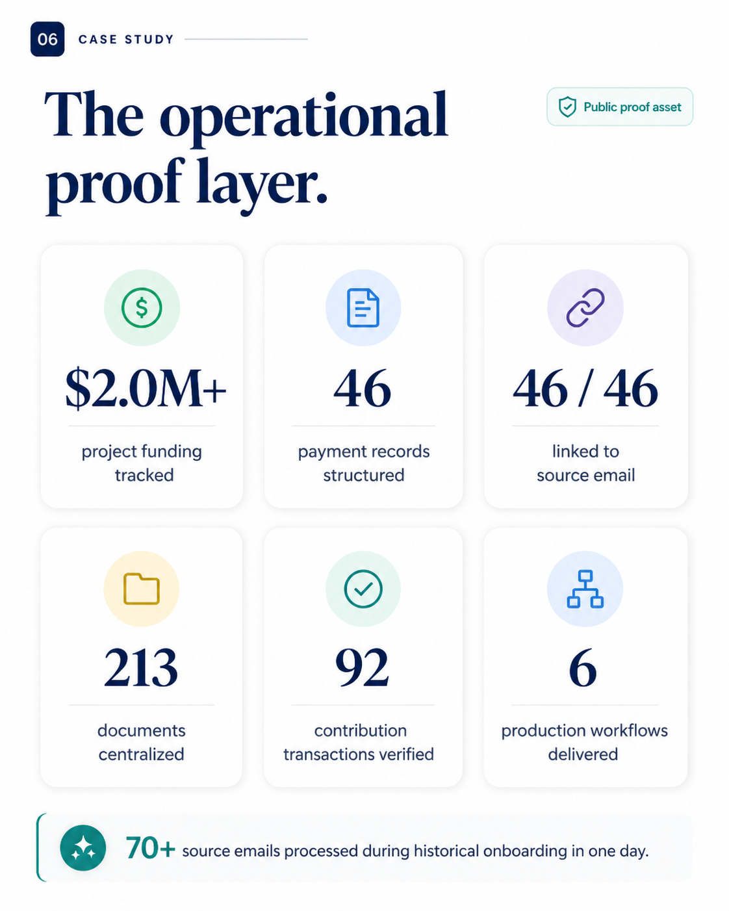
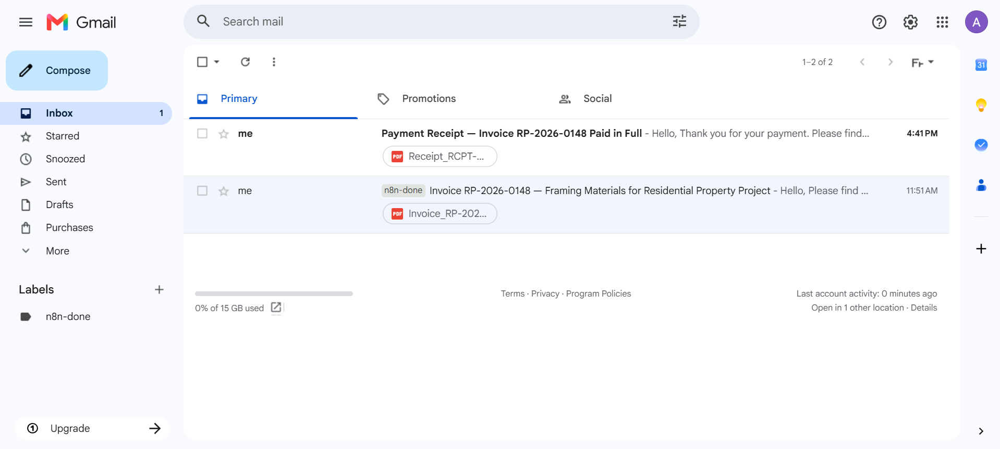

# AI Financial Admin Automation

A six-workflow n8n system that turns a mailbox full of invoices, quotes, receipts and bank statements into a traceable financial record, where **no payment is marked paid until its supporting document is attached**.

Built and delivered for a client running a property construction project. The client is not named and no client data appears here. All six production workflows are included, with every name, address, identifier and credential removed. See [What was removed before publishing](#what-was-removed-before-publishing).

**In production since June 2026.**



## The problem

Financial administration on a construction project arrives as email. An invoice from a supplier, a quote to approve, a payment receipt, a bank statement, a contribution from one of the people funding the project. Each one has to be read, understood, recorded somewhere, and its document filed where someone can find it again six months later when a number is questioned.

Done by hand, two things fail. The recording is inconsistent, and the evidence drifts away from the record. By the time anyone asks "what is this payment for", the email is buried and the PDF is in a download folder.

## What the system does

```
Gmail (invoices, quotes, receipts, statements, contributions)
      |
      v
  Extract email context, including attachments
      |
      v
  Claude: structured extraction into typed records
      |
      v
  Route to the right table      ---------> Timeline (audit trail)
      |
      v
  Upsert the record             <--------- Documents sheet
      |                                      ^
      v                                      |
  Upload attachment to Drive  ---------------+
      |
      v
  Write the readable link back into the visible row
      |
      v
  Label the email as processed
```

Six workflows, all in [`workflows/`](workflows):

| Workflow | File | Nodes | Role |
|---|---|---|---|
| **Email ingestion** | `email-ingestion.json` | 43 | The live pipeline above. Gmail trigger, extraction, routing, upsert, document upload, `processed` label |
| **Historical backfill** | `historical-backfill.json` | 45 | A one-shot pass over the existing mailbox to build the record retroactively. Frozen after its run, deliberately kept separate from the live pipeline |
| **Telegram assistant** | `telegram-assistant.json` | 11 | Conversational queries over the live project data, with an authorization gate |
| **Daily payment alerts** | `daily-payment-alerts.json` | 4 | Scheduled check for overdue, due-soon and review-required items, pushed to Telegram |
| **Weekly summary** | `weekly-summary.json` | 5 | Scheduled financial digest, pushed to Telegram |
| **Error handler** | `error-handler.json` | 3 | Catches any failure in any of the above and alerts on a separate channel |

111 nodes and about 2,400 lines of JavaScript in code nodes. Document linking is not a seventh workflow: it lives inside the ingestion and backfill pipelines, which upload each attachment to Drive, record it in a hidden `Documents` sheet, and propagate the readable link back into the rows the client actually looks at.

A Telegram assistant sits on top: an authorised user asks a question in plain language, the system fetches the relevant sheet context, Claude answers against it, and the answer carries links back to the source email and the source document.

## Results



Measured on the delivered system:

| | |
|---|---|
| In production since | **June 2026**, with no corrective work needed since |
| Records linked to their source email | **46 / 46** |
| Payment records structured | **46** |
| Documents centralized | **213** |
| Contribution transactions verified | **92** |
| Production workflows delivered | **6** |
| Project funding tracked | **$2.0M+**, on the historical back-fill |
| Source emails processed during onboarding | **70+**, in one day |

**Honest framing.** These are onboarding-phase figures, not a running cumulative total. The time saved on that phase is a client estimate of around 17.5 hours, derived from their own estimate of handling time per email, not a measured post-deployment figure. The traceability figure applies to the anonymized public proof layer shown in the screenshots.

## The design decisions worth reading

**A record is not complete until its evidence is attached.** A payment stays `pending` while its supporting document is missing, even when the amount and the date are known. The status field answers "can I prove this", not "did I type this in". The evidence is recorded next to the status, in `paid_evidence_source` and `paid_evidence_detail`, so a status can always be traced back to the thing that justified it. That one rule is what makes the record defensible six months later.



**The model's output is normalized against allow-lists, not trusted.** A status has to be one of `PENDING`, `PAID`, `PARTIALLY_PAID`, `DEPOSIT_PAID`, `AUTO_PAID`, `EXCLUDED` or `UNKNOWN`. Anything else becomes `UNKNOWN` rather than being written through to the sheet. Document types, payers and transaction relevance work the same way. A quote can never be flipped to paid, whatever the evidence looks like. See `normalizeStatus` in the `Parse and Normalize` node.

**Payers are a closed list, resolved by alias.** Incoming money comes from a known payer or from `Unknown`. The resolver matches aliases rather than exact strings, because the same payer appears in a bank line, an email signature and a handwritten receipt under three different spellings. Unrecognised becomes `Unknown` and waits for a human instead of being guessed into the wrong account.

**What gets sent to the model is decided before the call, not after.** Quotes are classified from their text alone, so their PDFs are never uploaded. Receipts, bills and bank statements need the image, so those are sent. Then two hard ceilings apply, 6 MB per file and 14 MB per request, and anything skipped is recorded by name. Sending every attachment to a vision model because it is simpler to code would have multiplied the bill for no extraction gain.

**A failed extraction is an event, not a silence.** When the model returns something unusable, the failure is appended to the timeline and the email is deliberately left without its `processed` label, so the next run picks it up again. Nothing is dropped quietly, and nothing is marked handled just because the code reached the end without throwing.

**Document links are owned by the nodes that write documents, and by nothing else.** An early version let the core upserts write every field on a row, and they silently wiped the document links each time a record was updated. The fix was ownership: the upsert owns the financial fields, the document nodes own the document fields, and the two never write to the same columns.

**A hidden table for machines, visible tables for humans.** Documents live in their own sheet with their own identifiers and their relation to the record they support. What the client sees is a readable link in the row they were already looking at. The structure serves the system, the surface serves the person.

**The backfill is a separate, frozen workflow.** Rebuilding history and processing today's mail are different problems with different failure modes. Keeping them apart means a change to the live pipeline can never corrupt the historical record, and the backfill can be re-read as evidence of what was imported and when.

**Errors alert on a different channel from business events.** A failed execution concerns the person who built the system. An overdue payment concerns the person running the project. They do not share an inbox.

**Error notifications are sent as plain text, on purpose.** Raw error messages routinely contain characters that break Telegram's Markdown parser, so the alert that tells you something is broken breaks too. Plain text is the reliable choice.

**The assistant checks who is asking before it answers.** A Telegram bot that reads a financial tracker is an access path. The sender is verified before any context is fetched.

**Routing uses phrase matching, not clever regular expressions.** Intent routing covers links, pending payments, contributions, operating expenses, invoices, payments, quotes, documents, timeline and summaries. Simple matching proved more maintainable, and it sidesteps a known parsing issue with regular expressions in n8n code nodes.

**Every production workflow declares the error workflow explicitly.** It is not inherited and it is not assumed. If it is not set, failures are silent.

## What the mailbox looks like going in



The screenshots in this repository come from the anonymized demonstration layer built for the public case study, not from the client's live account.

## Running it yourself

1. Import the six JSON files into n8n.
2. Create the credentials the nodes expect: Gmail OAuth2, Google Sheets OAuth2, Google Drive OAuth2, Telegram, and an Anthropic credential. Every node points at `REPLACE_WITH_YOUR_CREDENTIAL_ID`.
3. Replace the placeholders: `REPLACE_WITH_YOUR_SHEET_ID`, `REPLACE_WITH_YOUR_DRIVE_FOLDER_ID`, and the mailbox `project-mailbox@example.com`.
4. The `Claude API` nodes carry `REPLACE_WITH_YOUR_ANTHROPIC_KEY` as a header value. That is how the original was built and it is not how it should be done: use an n8n credential instead of a header.
5. Create the spreadsheet tabs the routing writes to: invoices, operating expenses, quotes, contributions, bank transactions, payments, documents, timeline.
6. Rewrite the payer allow-list in `Parse and Normalize`, `Explode Contributions` and `Explode Bank Transactions` for your own payers. This is most of the work of reusing the system.
7. Set `Financial Tracker - Error Handler` as the error workflow on the other five. It is not inherited.

## What was removed before publishing

No logic changed. What was stripped:

- the owner's first name and surname, including inside the extraction and assistant prompts;
- the property address and its postcode;
- the payer and family names, replaced by `PAYER_A`, `PAYER_B` and `PAYER_C`, which is exactly the shape the allow-list already had;
- the bank's name, which was a keyword in the statement-detection regex;
- the project mailbox address;
- the Google Sheet id, the Drive folder id and the cached resource names;
- all credential ids and names, one of which contained the client's surname;
- webhook ids, the n8n instance id, and the twenty-two server-side keys the n8n REST API adds to an export, including `homeProject` and `usedCredentials`, which carry the account owner's name and email;
- an Anthropic API key that had been pasted into a header instead of a credential.

This is done by a script, not by hand. It replaces what it knows about, then checks the output against a list of eighteen patterns that must never appear, and refuses to write any file where one survives. A dirty export cannot reach a commit by accident. Two leaks got through the replacement pass during this work and were caught by that second check: a credential named after the client, and a postcode left stranded when its street address was removed.

What is published is therefore a working template, not a copy of the client's running system. The payer list is three placeholders and the bank keyword is gone, so the routing has to be re-taught before it fits anyone else.

The companion repository, built the same way: [opspilot-ai-lead-intake](https://github.com/AntoineMoineaux/opspilot-ai-lead-intake), a lead intake and qualification system with its four workflows.

## License

MIT.
